# REST vs GraphQL vs gRPC

A hands-on comparison of three API paradigms built over the same domain — a library of books and authors. Run the demos to see the differences live, and use the visual flows and deep-dives below to prepare for interviews.

---

## Table of Contents

1. [Project setup & running](#setup)
2. [Architecture overview](#architecture)
3. [REST — how it works](#rest)
4. [GraphQL — how it works](#graphql)
5. [gRPC — how it works](#grpc)
6. [Side-by-side comparison](#comparison)
7. [Interview quick-reference](#interview)

---

## Setup <a name="setup"></a>

### With Docker (no Node.js needed)

```bash
# Build and start all three servers in the background
docker compose up --build -d

# Run a demo (servers must be up first)
docker compose run --rm demo-rest
docker compose run --rm demo-graphql
docker compose run --rm demo-grpc

# Start only specific servers
docker compose up -d rest graphql

# Stop everything
docker compose down
```

### Locally (Node.js 18+ required)

```bash
npm install
```

Open three separate terminals:

```bash
npm run rest        # → http://localhost:3001
npm run graphql     # → http://localhost:4000
npm run grpc        # → localhost:50051
```

Run demos from a fourth terminal (servers must be running):

```bash
npm run demo:rest
npm run demo:graphql
npm run demo:grpc
```

---

## Architecture overview <a name="architecture"></a>

All three servers share the same in-memory data from `shared/`. No database — data resets on server restart.

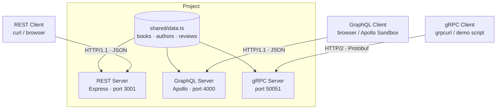

```
shared/               shared types and in-memory data
rest/server.ts        Express — port 3001
graphql/server.ts     Apollo Server — port 4000
grpc/
  proto/library.proto service contract and message definitions
  server.ts           gRPC server — port 50051
demos/                runnable scripts that call each API and explain the output
```

---

## REST — how it works <a name="rest"></a>

### Core idea

REST (Representational State Transfer) is an architectural style proposed by Roy Fielding in 2000. It models an API as a set of **resources**, each with its own URL, interacted with through standard HTTP verbs.

```
GET    /books          → list all books
GET    /books/1        → get one book
POST   /books          → create a book
PUT    /books/1        → replace a book
PATCH  /books/1        → partially update a book
DELETE /books/1        → delete a book
```

### Request / response flow

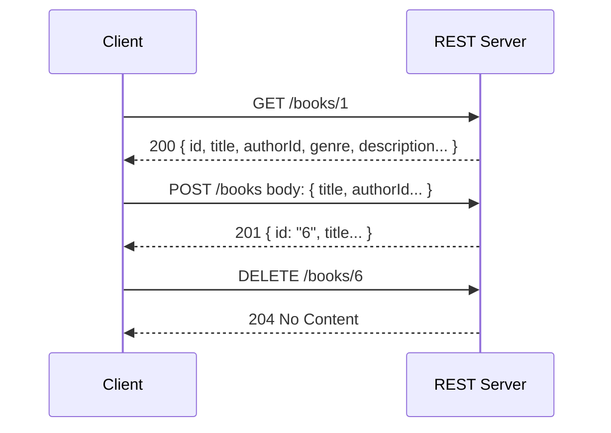

### The under-fetching problem

To render one book card showing **title + author name + average rating**, REST needs **three separate HTTP requests**:

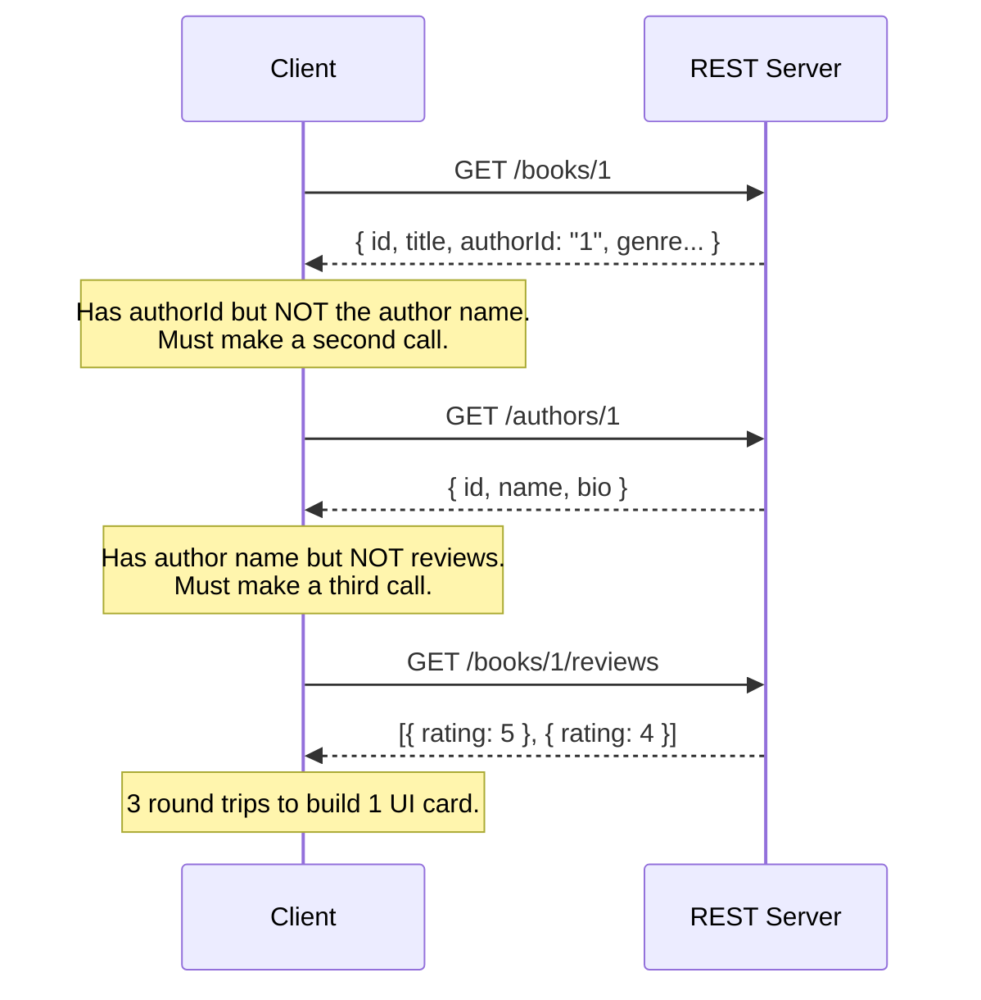

### The over-fetching problem

Even for a simple title list, REST returns every field on every resource:

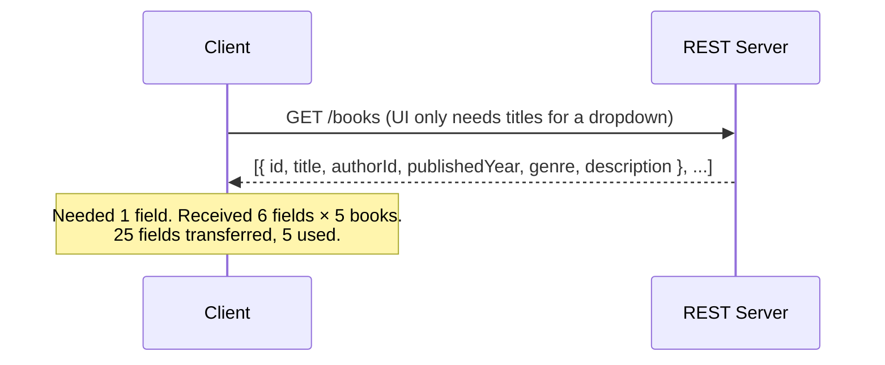

### The 6 REST constraints (Fielding's original definition)

| Constraint | What it means |
|---|---|
| **Client–server** | UI and data storage are separated |
| **Stateless** | Each request carries all the context it needs — no session on the server |
| **Cacheable** | Responses must declare whether they can be cached |
| **Uniform interface** | Resources are identified by URIs; interactions are standardised |
| **Layered system** | Client doesn't know if it's talking to the real server or a proxy/CDN |
| **Code on demand** *(optional)* | Server can send executable code to the client (e.g. JavaScript) |

### HTTP verbs and idempotency

Idempotent means calling the same operation multiple times produces the same result as calling it once — important for safe retries.

| Verb | Idempotent? | Safe? | Typical use |
|---|---|---|---|
| GET | ✔ | ✔ | Read |
| PUT | ✔ | ✗ | Full replace |
| DELETE | ✔ | ✗ | Remove |
| POST | ✗ | ✗ | Create, non-idempotent actions |
| PATCH | ✗ | ✗ | Partial update |

### HTTP status codes to know

| Code | Meaning |
|---|---|
| 200 OK | Success |
| 201 Created | Resource created (use with POST) |
| 204 No Content | Success, no body (use with DELETE) |
| 400 Bad Request | Malformed request from the client |
| 401 Unauthorized | Not authenticated |
| 403 Forbidden | Authenticated but not allowed |
| 404 Not Found | Resource doesn't exist |
| 409 Conflict | State conflict (e.g. duplicate) |
| 422 Unprocessable Entity | Validation error |
| 500 Internal Server Error | Server bug |

### REST versioning strategies

| Strategy | Example | Notes |
|---|---|---|
| URL path | `/v1/books` | Simple, explicit — most common |
| Header | `Accept: application/vnd.api.v2+json` | Clean URLs, harder to test in browser |
| Query param | `/books?version=2` | Easy but can pollute caches |

### When to choose REST

- Public-facing APIs (developers expect it)
- Simple CRUD with little nesting
- Teams that need HTTP-level caching (CDNs, ETags)
- When GET requests should be bookmarkable or shareable

---

## GraphQL — how it works <a name="graphql"></a>

### Core idea

GraphQL is a **query language for APIs** developed by Facebook in 2012. Instead of many endpoints there is one (`/graphql`). The **client declares exactly what it needs** — the server sends nothing more, nothing less.

### Request / response flow — solving REST's problems

The same three-request REST scenario becomes a single query:

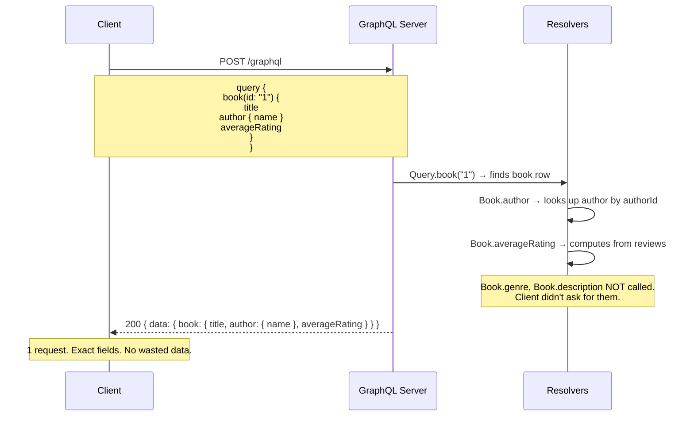

### How the resolver chain works

Every field in the schema can have a resolver. GraphQL only calls a resolver if the client's query includes that field. Unused fields cost nothing.

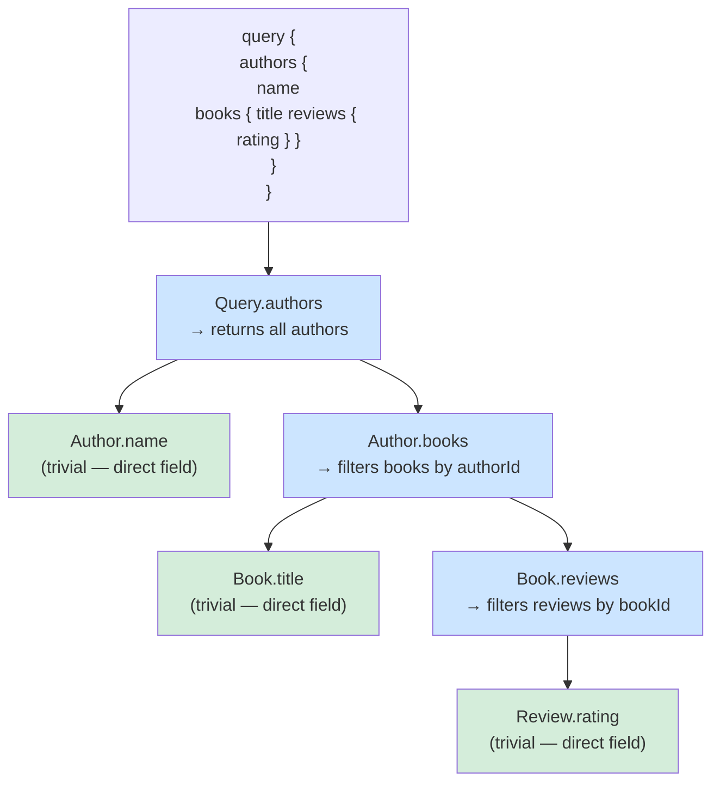

Green = trivial field access. Blue = resolver that does real work.

### The three operation types

| Type | Purpose | REST equivalent |
|---|---|---|
| `query` | Read data | GET |
| `mutation` | Write data | POST / PUT / PATCH / DELETE |
| `subscription` | Real-time event stream | WebSocket / SSE |

### The SDL schema — the client-server contract

```graphql
type Book {
  id: ID!
  title: String!
  author: Author!        # resolver runs only if client asks for this
  averageRating: Float   # computed on demand
}

type Query {
  book(id: ID!): Book
  books: [Book!]!
}
```

`!` means non-nullable. The SDL is self-documenting — clients can introspect it at runtime without reading any external docs.

### The N+1 problem

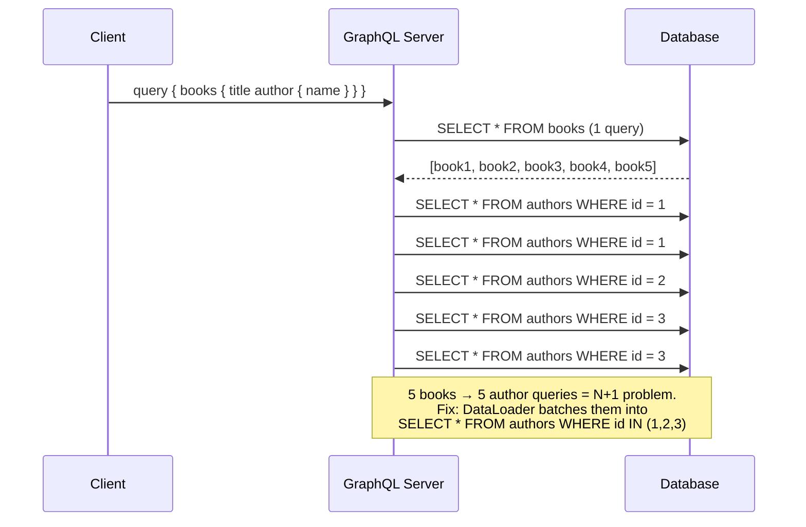

### Exploring this project's GraphQL API

Open **http://localhost:4000** for Apollo Sandbox, then try:

```graphql
# Precise query — only the fields you ask for
query {
  book(id: "1") {
    title
    author { name }
    averageRating
  }
}

# Deeply nested in one shot
query {
  authors {
    name
    books {
      title
      reviews { rating comment }
    }
  }
}

# Mutation
mutation {
  addBook(
    title: "God Emperor of Dune"
    authorId: "1"
    publishedYear: 1981
    genre: "Science Fiction"
    description: "Fourth Dune book."
  ) {
    id
    title
  }
}
```

### When to choose GraphQL

- Mobile clients where bandwidth matters
- Products with multiple front-end clients (web, iOS, Android) needing different shapes of the same data
- Rapidly evolving APIs where adding fields doesn't break existing clients
- Complex, deeply nested data requirements

---

## gRPC — how it works <a name="grpc"></a>

### Core idea

gRPC is a high-performance RPC (Remote Procedure Call) framework from Google. The client calls methods on a remote server **as if they were local functions**. The contract is a `.proto` file that drives code generation for both sides in any language.

### Overall architecture

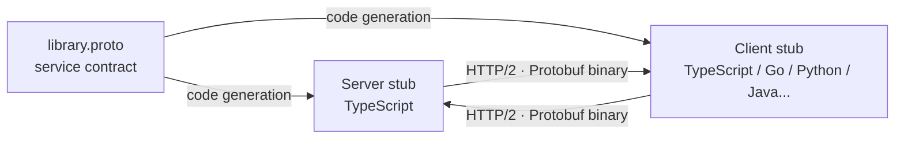

### The four communication patterns

This is gRPC's biggest differentiator — REST only has the first:

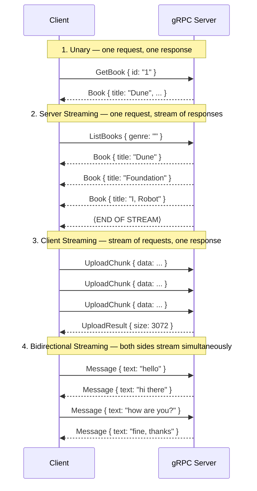

### Real-time push streaming

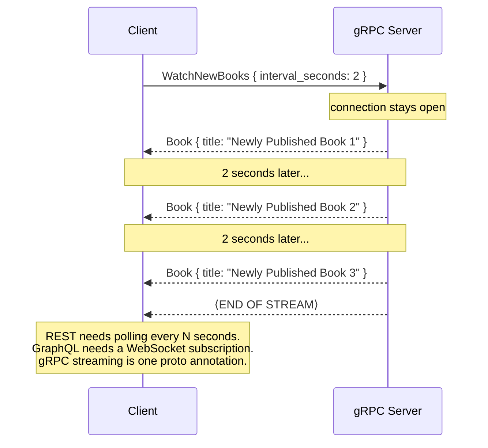

### Protocol Buffers — the wire format

Instead of JSON, gRPC uses binary Protocol Buffers. Fields are identified by their **number**, not their name.

```protobuf
message Book {
  string id    = 1;   // ← field NUMBER, not value
  string title = 2;
  int32  year  = 3;
}
```

```mermaid
graph LR
    subgraph JSON ~120 bytes
        J['{"id":"1","title":"Dune","publishedYear":1965}']
    end
    subgraph Protobuf ~25 bytes
        P["0a 01 31 12 04 44 75 6e 65 18 9d 0f ..."]
    end
    JSON -->|~40% smaller\n~6x faster to parse| Protobuf
```

**Critical rule:** never delete or reuse a field number. Old clients compiled against the previous schema would silently misread data if a number is reassigned. Deprecated fields are marked `reserved`.

### HTTP/2 transport advantages

| Feature | Benefit vs HTTP/1.1 |
|---|---|
| **Multiplexing** | Many concurrent RPCs over one TCP connection — no head-of-line blocking |
| **Header compression** | Repeated auth tokens and metadata compressed with HPACK |
| **Binary framing** | Lower overhead than HTTP/1.1 text frames |
| **Persistent connection** | Foundation for server streaming without polling |

### gRPC error codes

gRPC uses its own vocabulary — not HTTP status codes:

| Code | Value | Meaning |
|---|---|---|
| OK | 0 | Success |
| CANCELLED | 1 | Client cancelled the request |
| DEADLINE_EXCEEDED | 4 | Request timed out |
| NOT_FOUND | 5 | Resource doesn't exist |
| ALREADY_EXISTS | 6 | Conflict |
| PERMISSION_DENIED | 7 | Not authorised |
| UNAVAILABLE | 14 | Server temporarily unavailable |

### Exploring with grpcurl

```bash
brew install grpcurl

grpcurl -plaintext localhost:50051 list
grpcurl -plaintext -d '{"id":"1"}' localhost:50051 library.LibraryService/GetBook
grpcurl -plaintext -d '{"genre":""}' localhost:50051 library.LibraryService/ListBooks
```

### Browser limitation

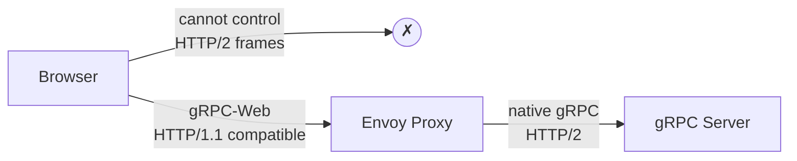

Browsers cannot use native gRPC. **gRPC-Web** is a spec that adapts it to HTTP/1.1 via a server-side proxy (typically Envoy).

### When to choose gRPC

- Internal microservice-to-microservice communication
- High-throughput or low-latency requirements (trading systems, mobile backends)
- Real-time streaming (sensor telemetry, live dashboards, file transfers)
- Polyglot systems where services are in different languages
- When a strictly enforced binary contract matters more than human-readability

---

## Side-by-side comparison <a name="comparison"></a>

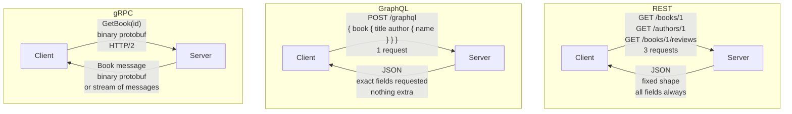

|  | REST | GraphQL | gRPC |
|---|---|---|---|
| **Endpoint** | One per resource | Single `/graphql` | One per method (in `.proto`) |
| **Schema / contract** | None by default (OpenAPI optional) | SDL — built in | `.proto` — built in |
| **Wire format** | JSON | JSON | Protocol Buffers (binary) |
| **Transport** | HTTP/1.1 | HTTP/1.1 | HTTP/2 |
| **Over-fetching** | Yes — fixed response shape | No — client selects fields | No — message types are exact |
| **Under-fetching** | Yes — multiple round trips | No — nested queries | No — compose messages as needed |
| **Streaming** | Not built in | Subscriptions (WebSocket/SSE) | Built in (4 patterns) |
| **Browser support** | Native | Native | Needs gRPC-Web proxy |
| **Caching** | HTTP caching (CDN-friendly) | Hard (single POST endpoint) | Application-level only |
| **Error model** | HTTP status codes | HTTP 200 + `errors` array | gRPC status codes |
| **Human-readable** | Yes | Yes | No (binary) |
| **Best for** | Public APIs, simple CRUD | Complex/nested data, mobile | Internal services, streaming |

---

## Interview quick-reference <a name="interview"></a>

### Common REST questions

**Q: What makes an API truly RESTful?**  
Following Fielding's six constraints — most importantly: stateless requests, a uniform interface (standard HTTP verbs + meaningful URIs), and cacheability. Most "REST" APIs in the wild are REST-ish — they skip HATEOAS and proper cacheability.

**Q: What is HATEOAS?**  
Hypermedia As The Engine Of Application State — responses include links to related actions so the client can navigate the API without hard-coded URLs. Rarely implemented in practice.

**Q: How do you handle versioning?**  
Most common: URL path (`/v1/`). More RESTful: `Accept` header versioning. Always avoid silent breaking changes.

**Q: GET vs POST — when would you use POST for a read?**  
When query parameters are too large for a URL, or contain sensitive data you don't want in server logs or browser history (e.g. complex search filters with PII).

---

### Common GraphQL questions

**Q: How does GraphQL prevent over-fetching?**  
The client's query lists exactly the fields it needs. Resolvers only execute for requested fields. The server never sends more than was asked for.

**Q: What is the N+1 problem and how do you fix it?**  
When resolving a list of N items where each item triggers a resolver that makes a DB call, you end up with N+1 total queries. Fix: **DataLoader** batches all those calls within one event-loop tick into a single `SELECT … WHERE id IN (…)`.

**Q: Why is HTTP caching harder with GraphQL?**  
All requests go to `POST /graphql`. HTTP caches work on URL + method. Two different queries have the same URL. Workarounds: persisted queries (APQ) and client-side normalised caches (Apollo Client, Relay).

**Q: What is introspection and why might you disable it in production?**  
Clients can query `__schema` to discover every type and field. Useful for tooling, but exposes your full data model to attackers — commonly disabled in production.

---

### Common gRPC questions

**Q: Why can't you use gRPC directly in a browser?**  
Browsers expose `fetch`/`XMLHttpRequest` which don't allow raw control of HTTP/2 frames. gRPC requires that control for streaming and binary framing. **gRPC-Web** adapts gRPC to HTTP/1.1 with a server-side proxy.

**Q: What happens if you reuse a Protocol Buffers field number?**  
The old client will interpret the new field's binary data as the old field's type, silently producing corrupted data. Always mark removed fields as `reserved` to prevent reuse.

**Q: What is the difference between unary and streaming RPCs?**  
Unary: one request, one response. Server streaming: one request, server sends a sequence. Client streaming: client sends a sequence, server replies once. Bidirectional: both sides stream concurrently over one open connection.

**Q: When would you use gRPC over REST internally?**  
When you need lower latency (binary format, HTTP/2 multiplexing), strict contracts between services, server-push streaming, or when services are in different languages and you want generated, type-safe clients everywhere.
