# REST vs GraphQL vs gRPC

A hands-on comparison of three API styles built over the same domain: a library of books, authors and reviews. Run the demos to see the differences live, then use the diagrams below to understand how each one works.

---

## Table of Contents

1. [Setup & running](#setup)
2. [Architecture overview](#architecture)
3. [REST — how it works](#rest)
4. [GraphQL — how it works](#graphql)
5. [gRPC — how it works](#grpc)
6. [Side-by-side comparison](#comparison)

---

## Setup <a name="setup"></a>

### With Docker (no Node.js needed)

```bash
# Build and start all three servers in the background
docker compose up --build -d

# Run a demo (servers must be up first)
docker compose run --rm demo-rest
docker compose run --rm demo-graphql
docker compose run --rm demo-grpc

# Start only specific servers
docker compose up -d rest graphql

# Stop everything
docker compose down
```

### Locally (Node.js 18+ required)

```bash
npm install
```

Start each server in its own terminal:

```bash
npm run rest        # → http://localhost:3001
npm run graphql     # → http://localhost:4000
npm run grpc        # → localhost:50051
```

Then run the demos from another terminal:

```bash
npm run demo:rest       # over-fetching & under-fetching
npm run demo:graphql    # the same data in one query
npm run demo:grpc       # binary protocol & streaming
```

---

## Architecture overview <a name="architecture"></a>

All three servers read the same in-memory data from `shared/data.ts`. There is no database, so data resets when a server restarts.

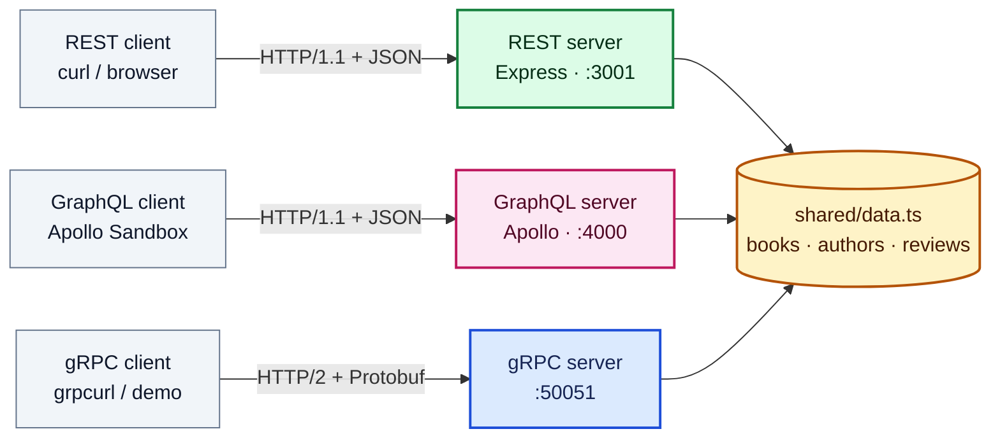

```
shared/               shared types and in-memory data
rest/server.ts        Express server
graphql/server.ts     Apollo Server
grpc/
  proto/library.proto service contract and message definitions
  server.ts           gRPC server
demos/                scripts that call each API and explain the output
```

---

## REST — how it works <a name="rest"></a>

### Core idea

REST models an API as a set of **resources**, each with its own URL. The client acts on them with standard HTTP verbs, and every request is stateless — it carries everything the server needs.

| Request | Meaning |
|---|---|
| `GET /books` | List all books |
| `GET /books/1` | Get one book |
| `POST /books` | Create a book |
| `PUT /books/1` | Replace a book |
| `DELETE /books/1` | Delete a book |

### Request / response flow

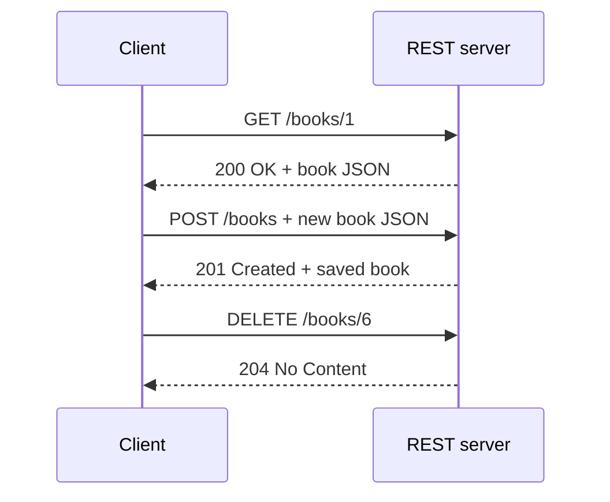

The HTTP status code tells the client what happened: `2xx` success, `4xx` client error, `5xx` server error.

### Under-fetching: too many round trips

To show one card with **title + author name + average rating**, the client needs three requests, because each endpoint returns only its own resource:

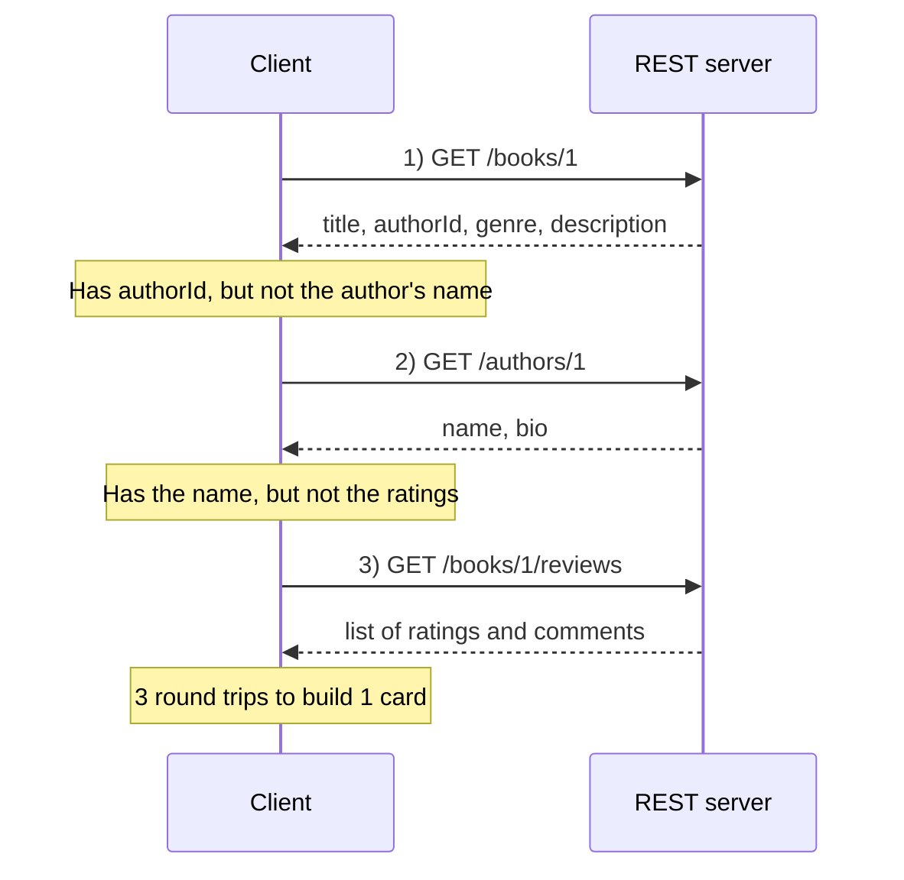

### Over-fetching: too much data

For a dropdown that only needs titles, the server still sends every field of every book:

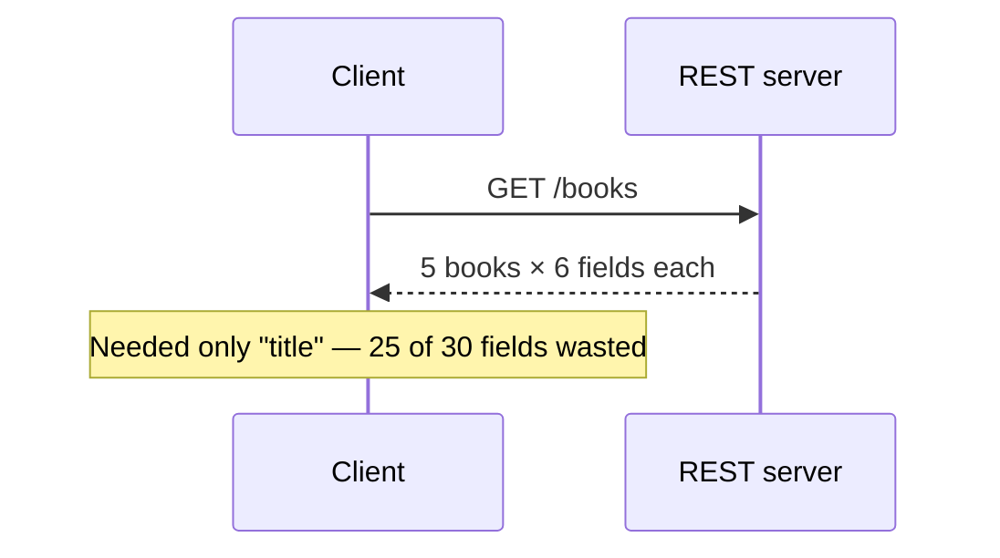

### Key properties

| Verb | Idempotent? | Use |
|---|---|---|
| GET | Yes | Read (safe, cacheable) |
| PUT | Yes | Full replace |
| DELETE | Yes | Remove |
| POST | No | Create |
| PATCH | No | Partial update |

*Idempotent* means repeating the call gives the same result as calling it once, so it is safe to retry.

### When to choose REST

- Public APIs that many developers will use
- Simple CRUD without deep nesting
- When you want HTTP caching from browsers and CDNs

---

## GraphQL — how it works <a name="graphql"></a>

### Core idea

GraphQL exposes **one endpoint** (`/graphql`) and a typed **schema**. The client sends a query describing exactly the fields it wants, and the response has exactly that shape.

| Operation | Purpose | REST equivalent |
|---|---|---|
| `query` | Read | GET |
| `mutation` | Write | POST / PUT / DELETE |
| `subscription` | Real-time updates | WebSocket / SSE |

### Request / response flow

The same book card that took three REST calls becomes one request:

```graphql
query {
  book(id: "1") {
    title
    author { name }
    averageRating
  }
}
```

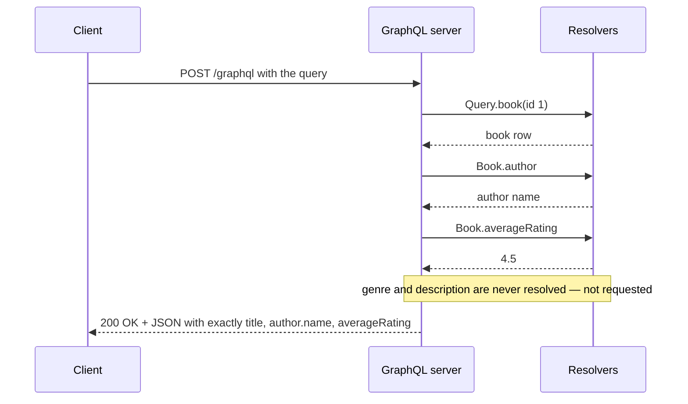

### How resolvers work

Each field in the schema can have a **resolver** function. GraphQL walks the query tree and calls a resolver only for the fields the client asked for.

For this query:

```graphql
query {
  authors {
    name
    books {
      title
      reviews { rating }
    }
  }
}
```

GraphQL runs this resolver chain:

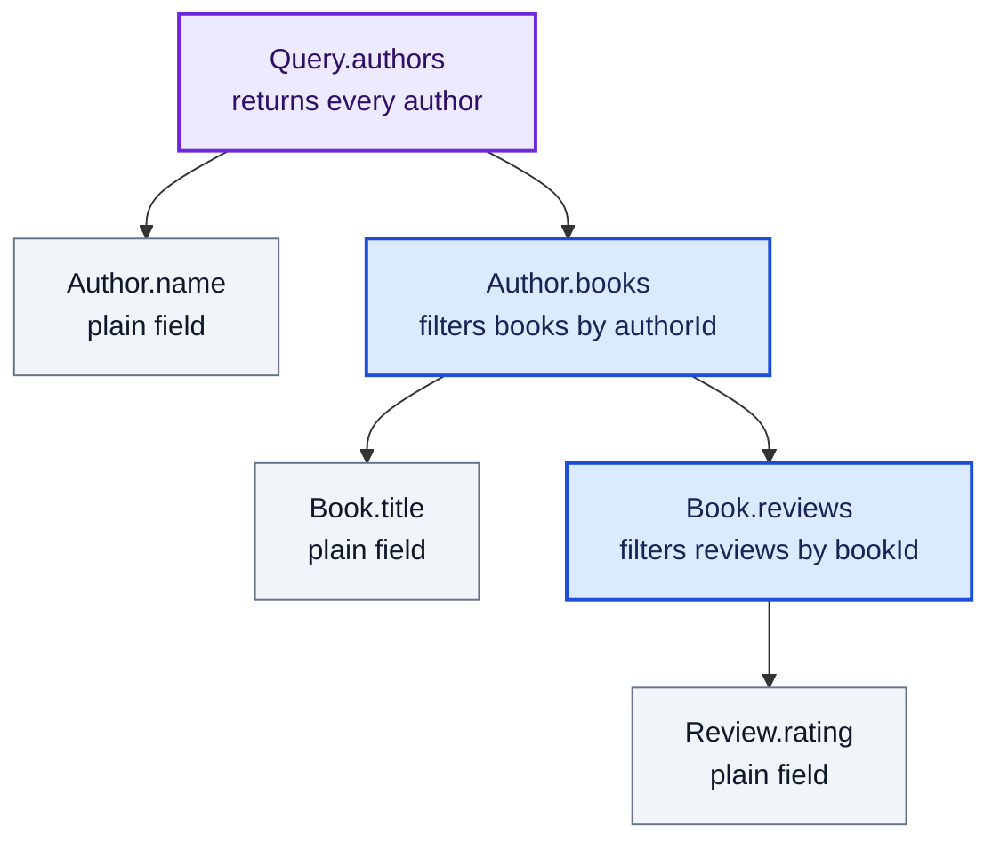

- **Purple** — root `Query` resolver, the entry point
- **Blue** — resolvers with real logic (they look up related data)
- **Grey** — plain fields, read straight off the parent object

`Book.author`, `Book.averageRating`, `Book.genre` and the rest are never called, because the query didn't ask for them.

### The N+1 problem

Resolvers run per item. Asking for every book's author runs the author resolver once **per book**:

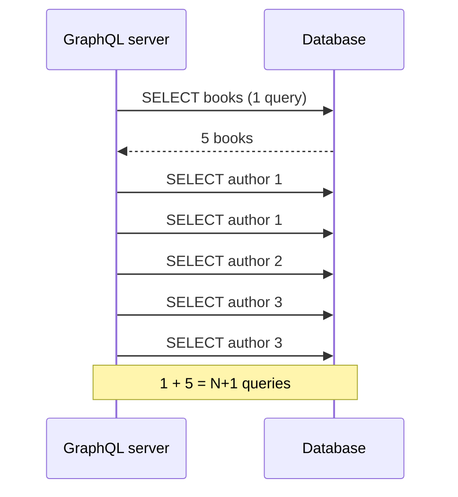

The standard fix is **DataLoader**, which collects those lookups and sends one batched query: `SELECT authors WHERE id IN (1, 2, 3)`.

### Try it

Open **http://localhost:4000** for Apollo Sandbox:

```graphql
# Nested data in one request
query {
  authors {
    name
    books {
      title
      reviews { rating comment }
    }
  }
}

# Write data
mutation {
  addBook(
    title: "God Emperor of Dune"
    authorId: "1"
    publishedYear: 1981
    genre: "Science Fiction"
    description: "Fourth Dune book."
  ) {
    id
    title
  }
}
```

### When to choose GraphQL

- Several clients (web, iOS, Android) that need different shapes of the same data
- Mobile apps where bandwidth matters
- Deeply nested, related data

---

## gRPC — how it works <a name="grpc"></a>

### Core idea

gRPC lets a client call a function on a remote server **as if it were local**. The contract lives in a `.proto` file, which tools use to generate matching client and server code in many languages. Messages travel as binary **Protocol Buffers** over **HTTP/2**.

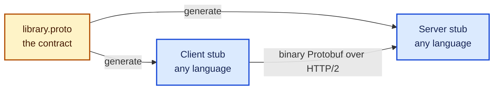

### Unary call (one request, one response)

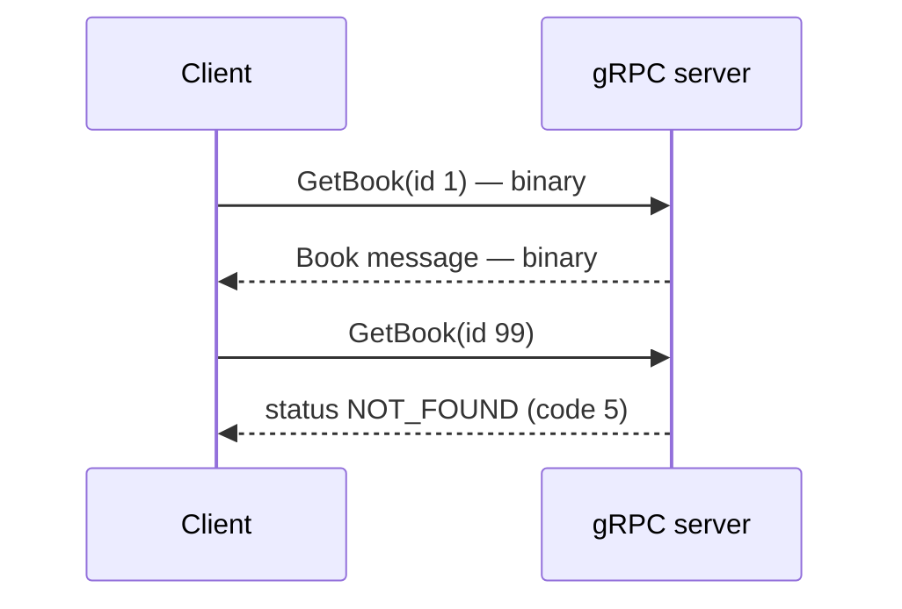

gRPC has its own status codes (`OK`, `NOT_FOUND`, `UNAVAILABLE`, `DEADLINE_EXCEEDED`…) instead of HTTP status codes.

### Server streaming (one request, many responses)

`ListBooks` sends each book as soon as it is ready, over one open connection:

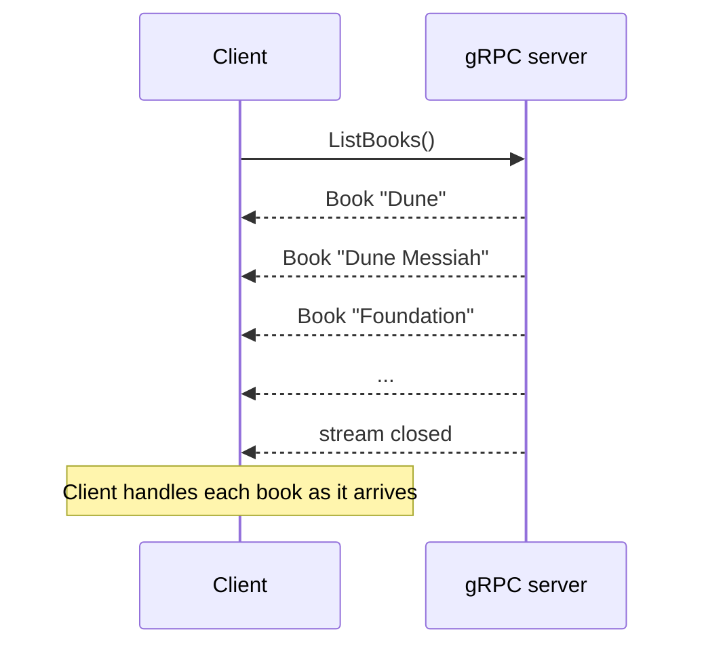

`WatchNewBooks` keeps the stream open and pushes events over time — something REST can only approximate with polling:

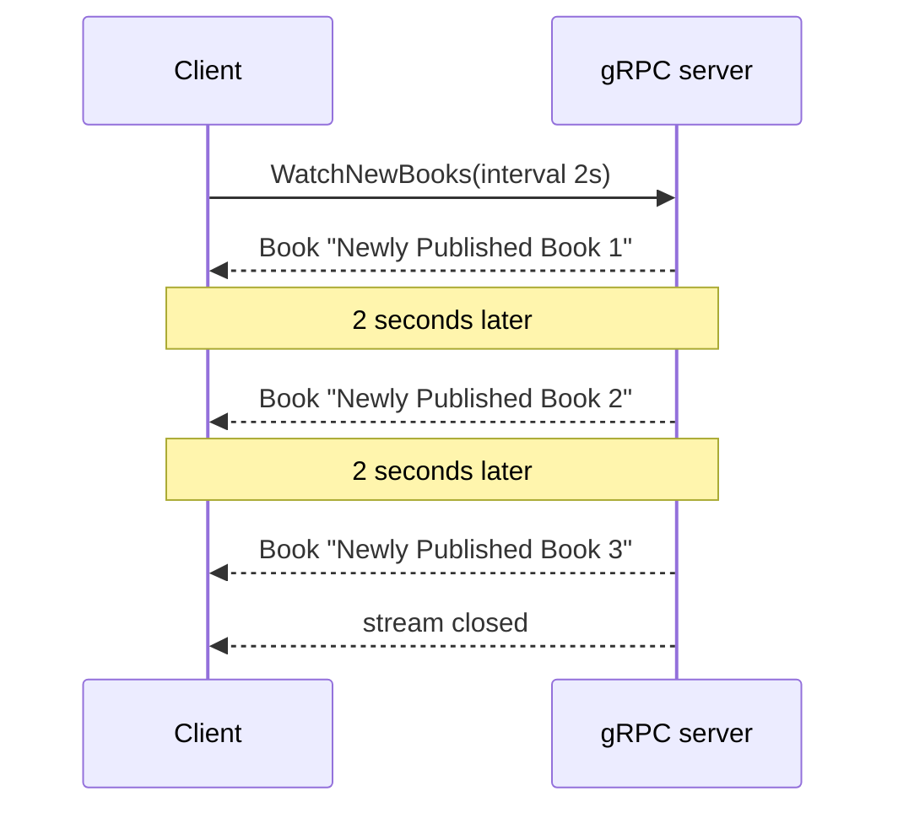

### The four call types

This project implements the first two.

| Type | Shape | Example use |
|---|---|---|
| Unary | 1 request → 1 response | Fetch a record |
| Server streaming | 1 request → many responses | Live feed, large export |
| Client streaming | many requests → 1 response | File upload |
| Bidirectional | many ↔ many | Chat |

### Protocol Buffers on the wire

Fields are identified by **number**, not name, which is why the binary form is so compact:

```protobuf
message Book {
  string id    = 1;
  string title = 2;
  int32  year  = 3;
}
```

```
JSON     {"id":"1","title":"Dune","year":1965}      37 bytes
Protobuf 0a 01 31  12 04 44 75 6e 65  18 ad 0f      12 bytes
         └─ id ─┘  └──── title ────┘  └ year ┘
```

Never reuse or delete a field number — older clients would decode the bytes as the wrong field. Mark removed numbers as `reserved` instead.

### Browsers

Browsers can't speak native gRPC, so web apps go through a proxy:

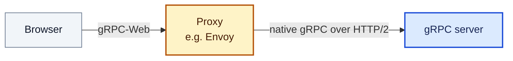

### Try it

```bash
brew install grpcurl

grpcurl -plaintext -import-path grpc/proto -proto library.proto \
  -d '{"id":"1"}' localhost:50051 library.LibraryService/GetBook

grpcurl -plaintext -import-path grpc/proto -proto library.proto \
  -d '{}' localhost:50051 library.LibraryService/ListBooks
```

(The server doesn't enable reflection, so grpcurl needs the `.proto` file passed in.)

### When to choose gRPC

- Service-to-service calls inside your backend
- High throughput or low latency
- Streaming data in either direction
- Teams using several programming languages

---

## Side-by-side comparison <a name="comparison"></a>

Fetching one book card (title + author name + rating):

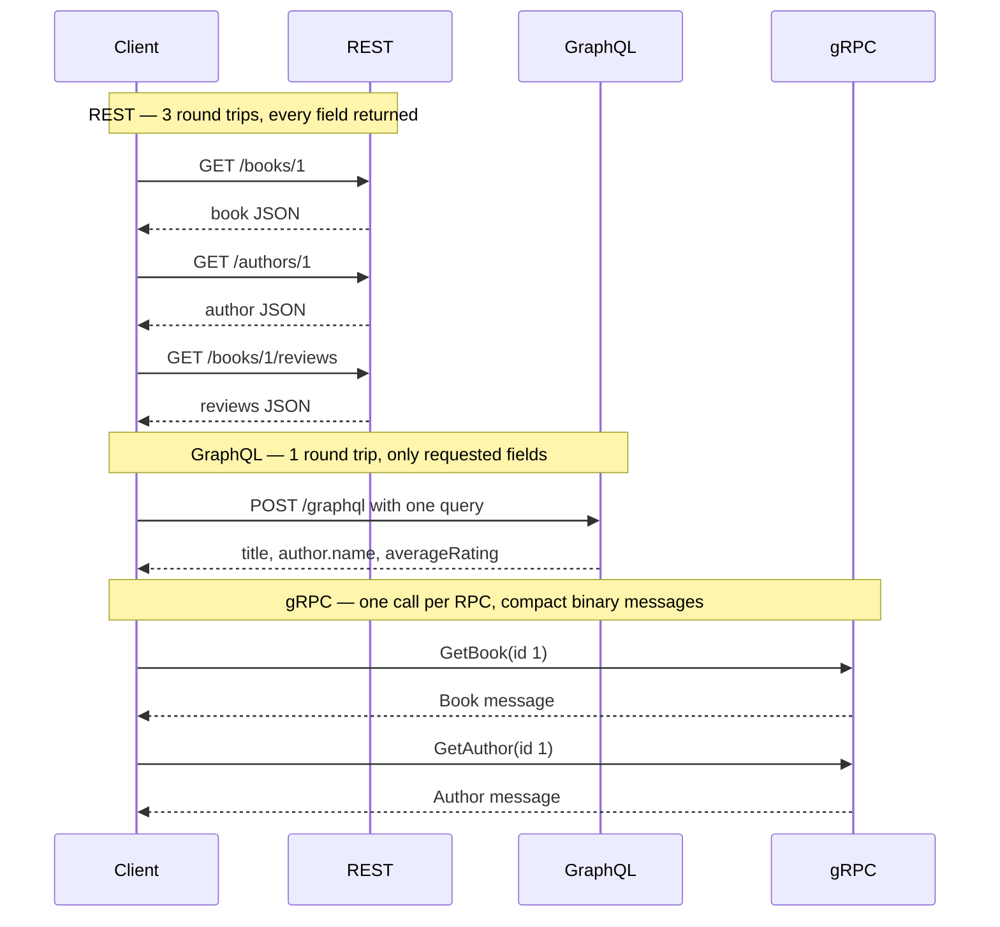

gRPC's response shape is fixed by the `.proto` file, like REST. To cut round trips you would add a purpose-built RPC (e.g. `GetBookCard`) that returns everything in one message. This project has no reviews RPC, so the rating isn't available over gRPC.

|  | REST | GraphQL | gRPC |
|---|---|---|---|
| **Endpoints** | One per resource | One (`/graphql`) | One per method |
| **Contract** | Optional (OpenAPI) | SDL schema | `.proto` file |
| **Format** | JSON | JSON | Protobuf (binary) |
| **Transport** | HTTP/1.1+ | HTTP/1.1+ | HTTP/2 |
| **Response shape** | Fixed by server | Chosen by client | Fixed by `.proto` |
| **Streaming** | No | Subscriptions | Built in |
| **Browser support** | Native | Native | Needs gRPC-Web proxy |
| **HTTP caching** | Easy | Hard | Not applicable |
| **Errors** | HTTP status codes | `errors` array in body | gRPC status codes |
| **Best for** | Public APIs, CRUD | Flexible client data needs | Internal services, streaming |
